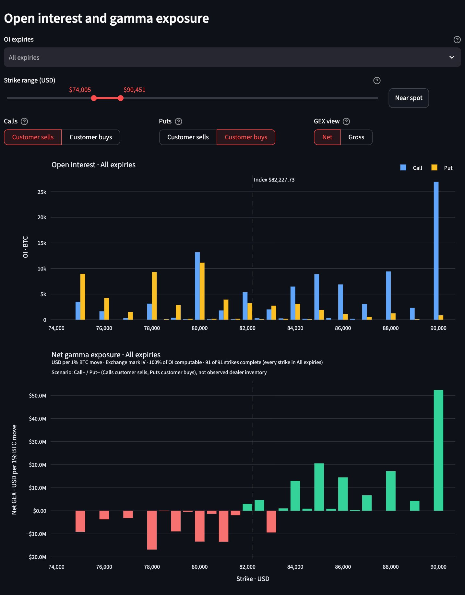
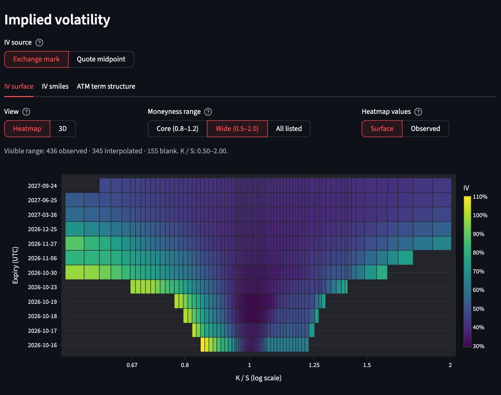
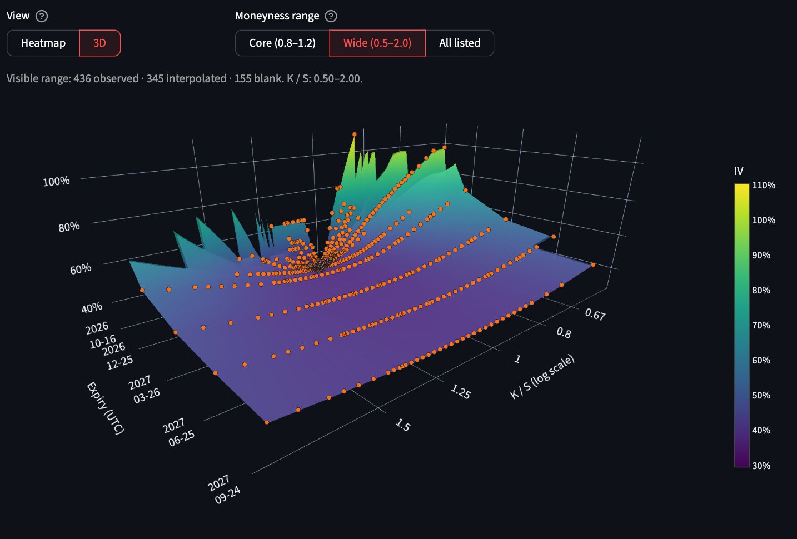
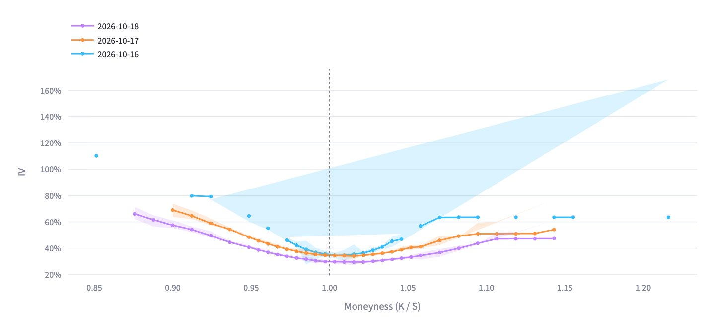
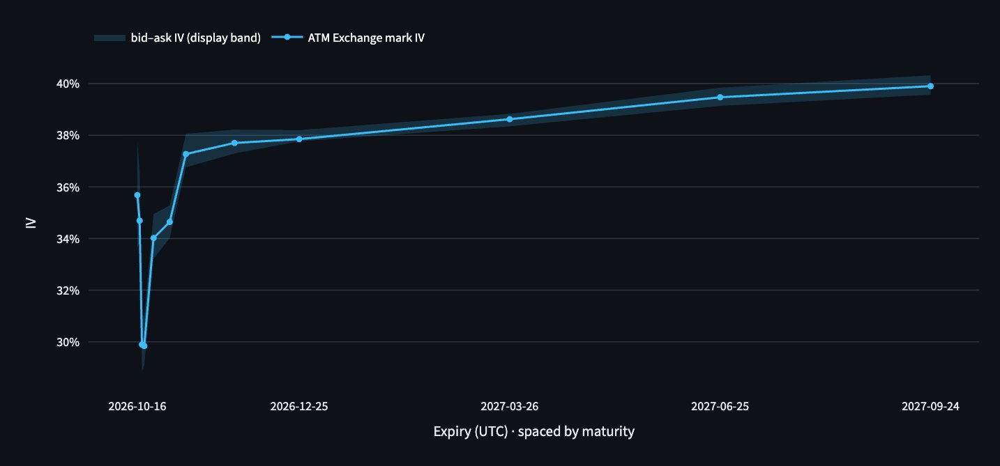

# crypto-options-analytics

An interactive dashboard for Bitcoin options on Deribit, built from the raw
exchange API. It shows where open interest and dealer gamma sit by strike,
and how implied volatility (IV) changes across strikes and expiries: an IV
surface, smiles and an ATM term structure.

Every number is computed from the unchanged Deribit responses, so any chart
can be traced back to what the exchange sent. It opens offline on a
checked-in snapshot, pulls a live one with one click, and saves an analysis
as a file that reopens to the same numbers. It is a research tool, not
trading infrastructure, and not financial advice.

**Live demo: [crypto-options-analytics.streamlit.app](https://crypto-options-analytics.streamlit.app)**



## Why it exists

Options prices carry two things a spot chart does not show: how much
volatility the market expects at each strike and horizon, and where hedging
flows could push the price. Exchange screens give the raw quotes; this
project turns them into those two pictures and states every assumption on
the way, so the result can be checked rather than trusted.

## Highlights

- **Own IV solver.** Implied volatility is solved from bid/ask midpoints with
  a Newton-Raphson root finder that falls back to bisection, under Deribit's
  inverse-option convention (premiums in BTC, each contract's own forward).
  A solve counts only if it reprices the quote within $0.01.
- **Two IV sources, side by side.** Deribit's own mark IV is the default; the
  solver's quote-midpoint IV is the comparison, with a shaded bid–ask band
  showing how wide the market really is.
- **One surface from Calls and Puts.** Each strike uses the out-of-the-money
  side (Puts below spot, Calls above, the average near spot), since
  in-the-money quotes are mostly intrinsic value and give unreliable IV.
- **Log-moneyness axes.** The surface, heatmap and smiles space strikes by
  log `K / S`, so put and call wings get equal width; labels and hover stay in
  `K / S`. The range opens on Wide (0.5–2.0) and goes from Core (0.8–1.2) to
  All listed, every strike Deribit lists.
- **Honest interpolation.** One surface is built per snapshot from every
  observed IV and each range shows a slice of it, so a cell has the same
  value in every view. Gaps are filled by linear interpolation of total
  variance (`IV² × T`) across moneyness and maturity at a fixed strike–time
  scale, only inside observed data; filled cells are labelled and nothing is
  extrapolated.
- **Gamma exposure with the assumption in plain sight.** GEX is in USD per 1%
  BTC move. Deribit does not publish who is long or short, so the dealer
  side is a control the user sets, and our gamma is tested against Deribit's
  own ticker gamma.
- **Missing stays missing.** Absent quotes and failed solves stay empty and
  charts show gaps, never zeros or silent substitutes.
- **Reproducible and tested.** Saved analyses keep the raw snapshot, not
  computed numbers. 282 tests run offline on the frozen snapshot in CI.

## Screenshots

Taken from the running dashboard on the checked-in snapshot captured
2026-10-15 15:18 UTC (index $82,227.73).

| IV surface heatmap | IV surface 3D |
| --- | --- |
|  |  |

| IV smiles | ATM term structure |
| --- | --- |
|  |  |

## Quick start

```bash
pip install -e .
python -m streamlit run app.py
```

Open the URL Streamlit prints (by default `http://localhost:8501`). The page
starts on the snapshot in `data/` with no network access; **Fetch latest**
pulls a live snapshot from Deribit's public API.

To run the tests:

```bash
pip install -e ".[dev]"
python -m pytest
```

## How it is built

Python, pandas, NumPy, SciPy, Plotly and Streamlit. The calculations and
figures live in the `options_analytics` package and import nothing from
Streamlit; the page lives in `app.py` and `dashboard/`.

| Module | Role |
| --- | --- |
| `deribit` | Fetch, validate and parse Deribit snapshots |
| `solver` | Black-Scholes pricing and the IV root finder |
| `iv_source` | Per-contract IV, the Call/Put combine rule, the bid–ask band |
| `surface_transforms` | Surface grid, interpolation, ATM proxy |
| `positioning` | Open interest, gamma and GEX by strike |
| `saved_analysis` | Save file format and validation |
| `visualization` | Plotly figures |

`experiments/` holds the research behind the choices: interpolation
methods compared on held-out points, Deribit's IV convention checked, and
mark IV compared with a second exchange.

## Limitations

- Black-Scholes European assumptions; Bitcoin on Deribit only.
- The GEX sign is a chosen scenario, not observed dealer inventory.
- The surface is an interpolated display, not an arbitrage-free fit.

## More detail

[docs/dashboard-guide.md](docs/dashboard-guide.md) is the full reference:
every chart and control, the formulas, the Combined IV and ATM rules, the
saved file format, the Deribit input and why each number can be checked.

## License

[MIT](LICENSE)
